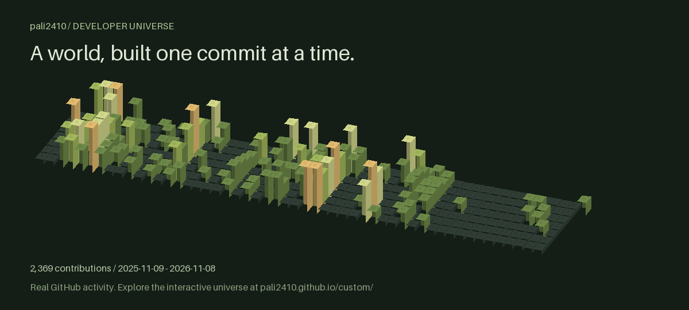
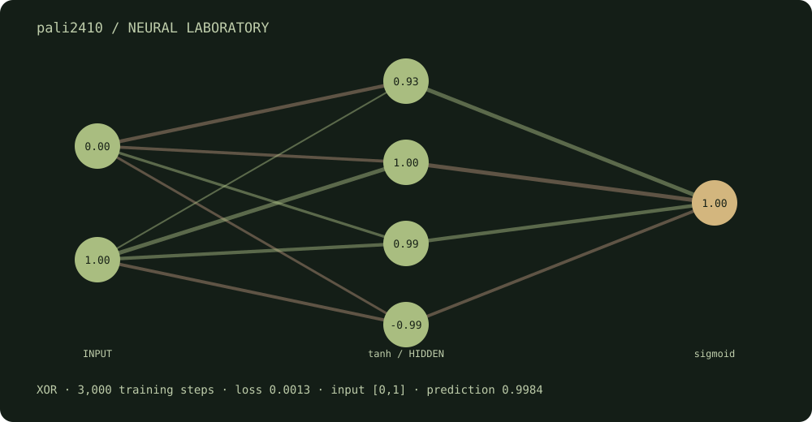

# custom · Developer Universe

The source for **pali2410’s interactive developer universe**. This application README is separate from the optional profile entrance in [docs/PROFILE-README.md](docs/PROFILE-README.md). No other repository is modified.



## Explore

- **Contribution landscape:** real GitHub calendar dates, current/previous-year switching, instanced brick bodies and studs, square-root height scaling, assembly animation, orbit controls, and date inspection.
- **Neural laboratory:** deterministic 2 → 4 → 1 network that learns XOR using full-batch backpropagation. Inspect activations, signed weights, prediction, epoch, and binary cross-entropy loss.
- **Physics workbench:** Rapier gravity, cuboid collision bodies, friction, restitution, stacking, bounded tray, drop and rebuild controls. Studs are cosmetic; bricks do not mechanically snap together.
- **Project district:** modular buildings and links based on verified public repository metadata.



## Run locally

Requires Node.js 22 (or a version supported by Vite 7).

```sh
npm ci
npm run dev
```

Open the printed URL with `/custom/`. Production validation:

```sh
npm test
npm run build
npm run preview
```

## Verified data and assets

`public/data/github.json` is an explicitly timestamped GitHub GraphQL/REST snapshot. No contribution counts or project metadata are invented. The UI displays its capture date in the data view. Private activity visibility depends on GitHub account settings. Contribution heights are `min(14, 1 + ceil(sqrt(count) * 1.15))`; zero days have one recessed base layer. Multiple bricks represent layers of the same date, not additional contributions.

To refresh with an authenticated GitHub CLI:

```sh
npm run sync
python -m pip install Pillow==11.3.0
npm run assets
```

The PNG and animated GIF are generated from those same real dates. They work in Markdown; JavaScript/WebGL stays in the external app. Google Fonts and Drei’s font loader require connectivity; system fonts provide a UI fallback.

## GitHub Pages

The included workflow tests, refreshes data, generates assets, builds, and deploys on main pushes and daily at 02:20 UTC. PRs build/test without deployment. The workflow updates the deployed snapshot, not tracked source files. No personal access token is embedded in browser code. `GITHUB_TOKEN` queries public contribution data during CI.

In **this repository only**, enable Settings → Pages → Source → GitHub Actions, then push to `main` or dispatch the workflow. The intended production address is `https://pali2410.github.io/custom/`; this address is not evidence that deployment has completed. Vite’s `/custom/` base handles all bundle and data paths. Navigation uses section anchors, so no server route rewrite is needed.

## Rendering and scope

React 19, TypeScript, Vite, React Three Fiber, Drei, Three.js, and Rapier. Procedural geometry removes external model/texture dependencies. Contribution geometry uses two instanced draw calls; physics is lazy-loaded and capped at 60 bricks. Quality controls reduce device pixel ratio and shadows. Reduced-motion preferences show assembled contributions and pause physics/signals. The contribution table and repository links are available independently of WebGL. The network is an educational simulation, not a claim about personal AI research.

This implementation uses real-time PBR materials and directional lighting. It does not implement Unreal-style global illumination, volumetric lighting, a full engineering city, or mechanical brick joints. Browser and device performance depend on GPU capability. See [docs/VERIFICATION.md](docs/VERIFICATION.md) for observed checks and outstanding publishing access.
