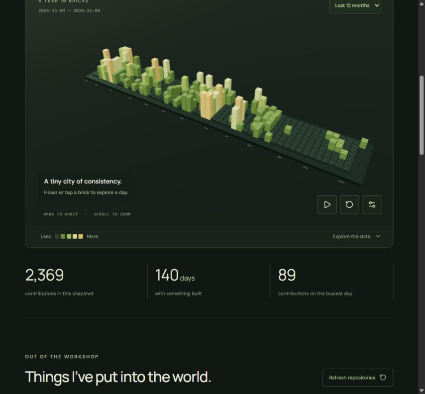

# Verification · 8 November 2026

Only the local clone of `pali2410/custom` was changed. No other remote repository was modified, no profile repository was created, and the original README heading and Git history were retained.

## Passed

- Production TypeScript compilation and Vite build.
- Five automated tests: rolling/current/previous calendar totals reconcile to daily counts; dates are unique and contiguous; repository links belong to the requested account; backpropagation learns all XOR truth-table cases.
- All 15 production files served under `/custom/` with HTTP success and SHA-256 byte equality against their build outputs, including chunks, fonts, data, PNG, GIF, and SVG.
- Browser-rendered contribution landscape and real date inspection.
- Historical-year selector: 2025 dates and 813 total contributions verified in the UI against the fetched snapshot.
- Neural scene switch and training control: loss decreased from 0.8310 to 0.1860 after 500 steps, with updated prediction and activations.
- Physics scene: rigid bodies rendered, settled on the tray, and the drop control increased the count from 20 to 25.
- Project scene switched successfully without losing the WebGL context.
- Animation pause and high/low quality controls worked without canvas replacement.
- Phone breakpoint checked with a 390 × 844 browser override; document width did not exceed the reported viewport width. Override reset afterward.
- No browser console errors on the final contribution/neural build. Rapier emitted a dependency initialization deprecation warning while testing physics.
- Dependency installation reported zero known audit vulnerabilities.

## Remaining limits

- No production deployment or GitHub-rendered profile integration has occurred. GitHub API permissions for the active CLI account (`ecoagritechoperations-sketch`) reported `push: false` and `admin: false` for `pali2410/custom`. Publishing requires an account authorized to write this repository and configure its Pages source. No access to any other repository is needed for this deployment.
- The workflow is prepared but has not run on GitHub. Its repository-scoped token and Pages environment still require a live CI deployment check.
- Vite reports the lazy-loaded Rapier/WASM physics chunk at about 2.26 MB uncompressed / 838 KB gzip. Initial contribution rendering does not load that chunk.
- Only the available Chromium-based browser was tested. No Safari, Firefox, physical mobile device, or sustained GPU performance benchmark was run.
- The scene uses directional-light PBR shading, procedural bricks, and simplified collision bodies. It does not provide photorealistic global illumination, volumetric lighting, a full engineering city, or mechanical snapping/joints. The profile entrance remains an optional file inside `custom` per the repository restriction.
